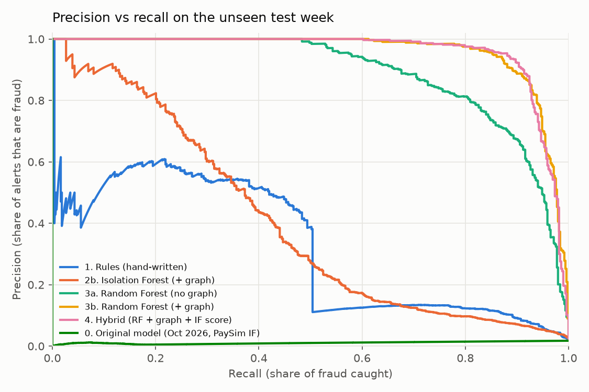
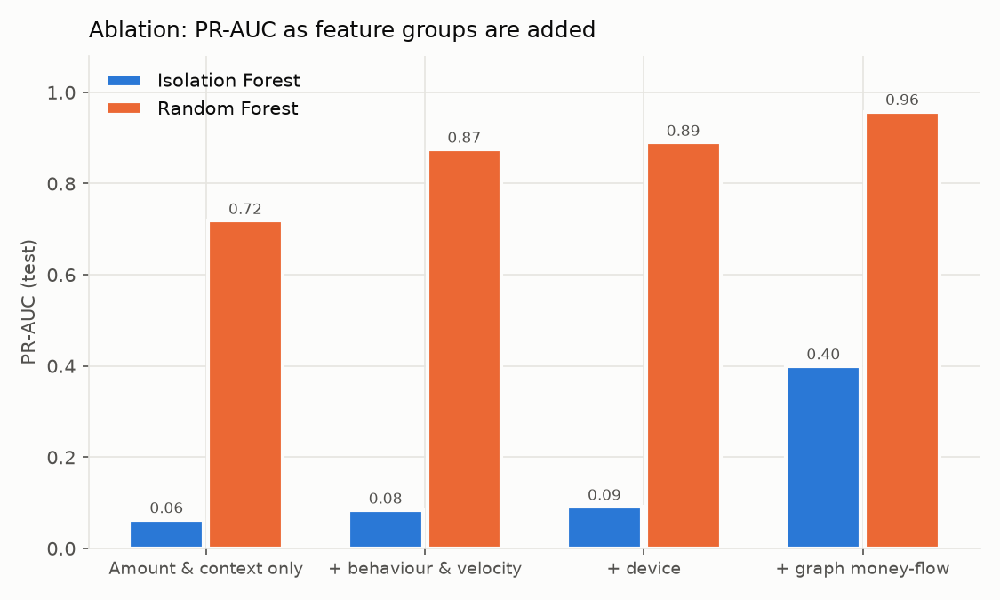
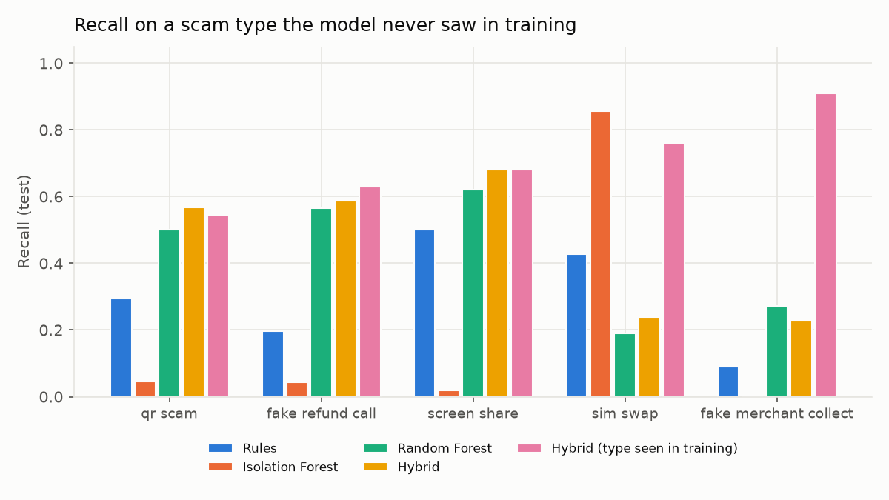
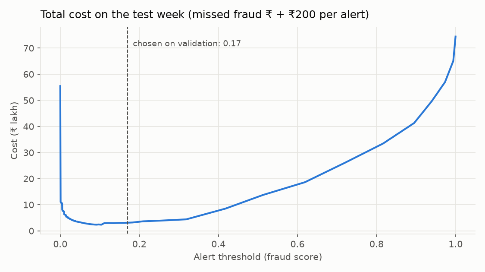
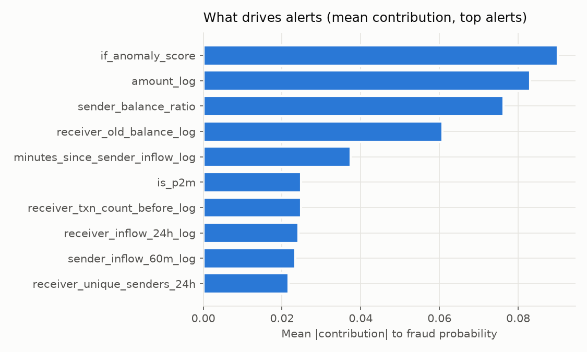

# Results: UPI scam & mule detection

_Generated automatically by `train_and_evaluate.py` on 2026-10-26 19:26. Every number below comes from the code in this repository; re-running the script reproduces it._

## 1. Data

- Simulated UPI payments: **127,134** over 30 days, 4,000 customers, 250 merchants (`upi_simulator.py`, seed 7).
- Time-based split (no shuffling, so the model is always tested on the future):

| Part | Days | Payments | Fraud payments | Fraud rate |
|---|---|---|---|---|
| Warm-up (history only, not scored) | 0–2 | – | – | – |
| Train | 2–18 | 69,992 | 1,405 | 2.0% |
| Validation (thresholds chosen here) | 18–23 | 20,557 | 430 | 2.1% |
| Test (reported below) | 23–30 | 27,734 | 488 | 1.8% |

Fraud payments by type (whole dataset): mule_layering 1511, screen_share 233, fake_refund_call 226, qr_scam 144, fake_merchant_collect 115, sim_swap 94.

> Fraud is over-represented on purpose (about 1–2% of payments) so models see enough examples. Real UPI fraud rates are far lower, so real-world precision would be lower than shown here. All results are on simulated data; they show the method works and how the parts compare, not how it would perform at a real bank.

## 2. Model comparison (test week)

Thresholds are chosen on the validation days only. **Cost threshold** minimises missed fraud ₹ + ₹200 per alert. **Budget** = analysts review the top 2% of payments.

| Model | PR-AUC | Precision @budget | Recall @budget | Precision @cost | Recall @cost | ₹ recall @cost | Alerts/day @cost | Saving vs no model |
|---|---|---|---|---|---|---|---|---|
| 0. Original model (Oct 2026, PaySim IF) | 0.011 | 0.3% | 0.8% | 1.7% | 98.4% | 98.2% | 3961 | ₹20.3 lakh |
| 1. Rules (hand-written) | 0.322 | 47.2% | 45.3% | 11.8% | 84.4% | 98.0% | 499 | ₹68.6 lakh |
| 2a. Isolation Forest (no graph) | 0.091 | 11.6% | 15.4% | 5.8% | 90.6% | 95.8% | 1091 | ₹58.6 lakh |
| 2b. Isolation Forest (+ graph) | 0.400 | 41.2% | 42.2% | 7.0% | 90.6% | 95.0% | 906 | ₹60.6 lakh |
| 3a. Random Forest (no graph) | 0.890 | 86.3% | 72.1% | 53.7% | 94.1% | 98.2% | 122 | ₹74.0 lakh |
| 3b. Random Forest (+ graph) | 0.958 | 96.0% | 84.2% | 59.6% | 96.7% | 98.4% | 113 | ₹74.3 lakh |
| 4. Hybrid (RF + graph + IF score) | 0.957 | 95.7% | 86.1% | 71.3% | 94.3% | 97.6% | 92 | ₹74.0 lakh |

**How to read this:** PR-AUC and the *@budget* columns compare models fairly (same number of alerts). The *@cost* columns show each model at its own cost-optimal threshold; for weak models that threshold means alerting on hundreds or thousands of payments a day, which no fraud team could review.

## 3. Ablation: what each feature group adds

| Features | # | IF PR-AUC | RF PR-AUC | RF recall @budget | RF mule-layering recall @budget |
|---|---|---|---|---|---|
| Amount & context only | 8 | 0.062 | 0.718 | 65.4% | 75.4% |
| + behaviour & velocity | 18 | 0.083 | 0.875 | 71.3% | 83.9% |
| + device | 22 | 0.091 | 0.890 | 72.1% | 84.6% |
| + graph money-flow | 31 | 0.400 | 0.958 | 84.2% | 97.0% |

## 4. Recall by fraud type (same alert budget for every model: top 2%, test week)

| Model | qr_scam | fake_refund_call | screen_share | sim_swap | fake_merchant_collect | mule_layering |
|---|---|---|---|---|---|---|
| 1. Rules (hand-written) | 29.5% | 19.6% | 50.0% | 42.9% | 9.1% | 53.4% |
| 2b. Isolation Forest (+ graph) | 6.8% | 2.2% | 2.0% | 85.7% | 0.0% | 60.0% |
| 3a. Random Forest (no graph) | 25.0% | 50.0% | 58.0% | 52.4% | 90.9% | 84.6% |
| 4. Hybrid (RF + graph + IF score) | 54.5% | 63.0% | 68.0% | 76.2% | 90.9% | 97.4% |

## 5. Unseen scam types (zero-day test)

Each scam type is removed from training **and** validation, then the models are tested on that type only. This is the situation the unsupervised part is meant for. All models get the same alert budget (top 2% of payments), so recall is compared fairly.

| Held-out scam | Test payments | Rules | Isolation Forest | Random Forest | Hybrid | Hybrid (seen in training) |
|---|---|---|---|---|---|---|
| qr_scam | 44 | 29.5% | 4.5% | 50.0% | 56.8% | 54.5% |
| fake_refund_call | 46 | 19.6% | 4.3% | 56.5% | 58.7% | 63.0% |
| screen_share | 50 | 50.0% | 2.0% | 62.0% | 68.0% | 68.0% |
| sim_swap | 21 | 42.9% | 85.7% | 19.0% | 23.8% | 76.2% |
| fake_merchant_collect | 22 | 9.1% | 0.0% | 27.3% | 22.7% | 90.9% |

## 6. Graph layer: NetworkX ring escalation

Candidate rings found in the test week: **6**, of which **6** are mostly fraud (true rings active in the test week: 6). Share of payments inside detected rings that are truly fraud: **91.9%**.

| Setting | Alerts | True frauds | False alerts | Precision | Recall | Mule-layering recall | Total cost (₹ lakh) |
|---|---|---|---|---|---|---|---|
| Model alerts only | 645 | 460 | 185 | 71.3% | 94.3% | 99.0% | 3.17 |
| + every payment inside a detected ring | 691 | 476 | 215 | 68.9% | 97.5% | 99.0% | 1.80 |
| + ring payments that are fast pass-throughs (score ≥ 0.01) | 671 | 475 | 196 | 70.8% | 97.3% | 99.0% | 1.79 |

The escalation cut-off was chosen on the validation week. On the test week it catches **15 more frauds** for **11 more false alerts**, and lowers total cost from ₹3.17 lakh to ₹1.79 lakh, because a missed scam costs far more than a ₹200 review. Most of the graph's value is already inside the model through the graph money-flow features (section 3); ring detection adds the rest and gives investigators the whole ring to act on.

## 7. Choosing the threshold like a bank

Chosen operating point (validation): alert if fraud score ≥ **0.171**; 'High risk' if ≥ **0.311** (≥ 90% precision on validation).

Sensitivity to the assumed review cost (hybrid model, test week):

| Review cost per alert | Threshold | Alerts/day | Precision | Recall | ₹ recall |
|---|---|---|---|---|---|
| ₹50 | 0.095 | 137 | 49.5% | 97.3% | 99.3% |
| ₹200 | 0.171 | 92 | 71.3% | 94.3% | 97.6% |
| ₹1,000 | 0.181 | 89 | 73.7% | 94.1% | 97.4% |
| ₹5,000 | 0.311 | 69 | 91.3% | 90.4% | 95.5% |

## 8. Explanations

- Reason codes use exact tree-path contributions (max additivity error 5.6e-16).
- Checked against SHAP TreeExplainer on the top 150 test alerts: top reason identical in **82.0%**, top-3 overlap **83.6%**.

## 9. Demo datasets (new simulations, different seeds, smaller bank)

| Dataset | Payments scored | Warm-up rows | Fraud | Alerts | False-alert rate | Precision | Recall |
|---|---|---|---|---|---|---|---|
| dataset_1_normal_baseline.csv | 11,261 | 4,269 | 0 | 161 | 1.4% | 0.0% | – |
| dataset_2_scam_attacks.csv | 11,238 | 4,411 | 229 | 404 | 1.6% | 56.2% | 99.1% |
| dataset_3_mule_rings.csv | 11,862 | 4,704 | 193 | 376 | 1.6% | 48.9% | 95.3% |

## 10. Real-time scoring

`realtime_demo.py` replays payments one at a time through the same feature engine and model. Per-payment latency (features + model, single CPU core): median **0.9 ms**, 95th percentile **1.2 ms**, 99th **1.4 ms** over 2,000 payments.

## 11. Limitations (state these in the report and viva)

- Data is simulated. The scam patterns follow public descriptions of UPI fraud, but the exact numbers depend on simulator assumptions.
- Fraud is over-represented; precision at a real bank's base rate would be lower.
- The first 48 hours of any uploaded file lack history; those rows are shown as 'warm-up' and not scored for metrics. A real deployment would keep history in a feature store.
- The supervised model only learns scams it has seen; section 5 shows how much it drops on a new scam type.
- Ring detection looks at the whole batch (including later payments), so it is an investigation tool, not a real-time decision.